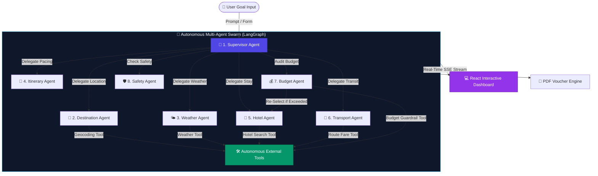

# 🧞‍♂️ TripGenie: An Agentic AI-Based Autonomous Travel Planner

<div align="center">

[](https://github.com/langchain-ai/langgraph)
[](https://fastapi.tiangolo.com/)
[](https://react.dev/)
[](https://www.mongodb.com/)
[](https://www.python.org/)
[](LICENSE)

*Transforming travel prompts into complete, budget-verified, multi-day itineraries with live agent streaming & PDF booking vouchers.*

</div>

---

> [!IMPORTANT]  
> **TripGenie is not just a single-prompt chatbot.** It is a **Fully Autonomous Goal-Directed Agentic System**. Given a high-level goal, a team of **8 Core AI Agents** collaborates autonomously, fetching live weather forecasts, calculating route logistics, enforcing strict financial limits, and generating real downloadable PDF booking vouchers.

---

## 💡 How TripGenie Works: The Autonomous Loop



---

## 🤖 The 8 Core Autonomous AI Agents

TripGenie's engine is powered by **8 primary specialized agents** executing in a LangGraph directed state graph:

```
┌──────────────────────────────────────────────────────────────────────────────────┐
│                                8 CORE AI AGENTS                                  │
├──────────────────┬─────────────────────────────────┬─────────────────────────────┤
│ Agent Icon & Name│ Core Focus Area                 │ Key Output                  │
├──────────────────┼─────────────────────────────────┼─────────────────────────────┤
│ 👑 Supervisor     │ Graph Orchestration & Routing   │ State Graph Execution Plan  │
│ 📍 Destination    │ Geo-Validation & Location Data  │ Coordinates & City Profiles │
│ 🌤️ Weather        │ Climate & Live Weather Forecast │ Outdoor / Indoor Planning   │
│ 📅 Itinerary      │ Schedule & Pacing Architecture  │ Hourly Activity Timeline    │
│ 🏨 Hotel          │ Lodging Search & Ranking        │ Budget-Aligned Stays        │
│ 🚗 Transport      │ Route & Transit Fare Calculator │ Flight/Train/Cab Logistics  │
│ 💰 Budget         │ Financial Guardrail & Audit     │ Cost Allocation & FX Audit  │
│ 🛡️ Safety        │ Advisories & Emergency Protocols│ Safety Scores & Hotlines    │
└──────────────────┴─────────────────────────────────┴─────────────────────────────┘
```

> [!NOTE]  
> **Supporting Agents:** Supporting domain agents include the *Attractions Agent*, *Restaurant Agent* (dietary filtering), *Packing Agent*, *Report Agent*, and *Chat Agent* for real-time trip Q&A.

---

### 📁 TripGenie-AgentVerse Structure

```
📁 TripGenie-AgentVerse
├── 📁 Core-Agents
│   ├── supervisor.py              # Orchestrator & Graph State Manager
│   ├── destination_agent.py       # Geocoding & Location Logistics
│   ├── weather_agent.py           # Climate & Live Forecast Analyst
│   ├── itinerary_agent.py         # Schedule & Pacing Architect
│   ├── hotel_agent.py             # Lodging Search & Ranking Matchmaker
│   ├── transport_agent.py         # Route & Transit Fare Calculator
│   ├── budget_agent.py            # Financial Guardrail & Audit
│   └── safety_agent.py           # Advisories & Emergency Monitor
│
└── 📁 Specialized-Support-Agents
    ├── attractions_agent.py       # Sightseeing & Cultural Spot Curator
    ├── restaurant_agent.py        # Dietary-Specific Dining Filter
    ├── packing_agent.py           # Weather-Based Gear Generator
    ├── report_agent.py            # Printable Travel Report Builder
    ├── emergency_agent.py         # Emergency Contacts & Hotline Provider
    ├── planner_agent.py           # High-Level Strategy Formulator
    └── chat_agent.py              # Real-Time Interactive Q&A Assistant
```

---

## 🌟 Key Platform Features

- ⚡ **Real-Time Agent Thinking Stream**: Watch agents reason, execute tools, and pass states live via Server-Sent Events (SSE).
- 💰 **Strict Budget Guardrails**: Automated self-correction prevents hotel and transit choices from exceeding user budget caps.
- 📄 **Instant PDF Vouchers**: Generate formatted PDF booking passes with barcodes and trip itineraries.
- 📍 **Interactive Maps & Route Pins**: Dynamic visual mapping of hotels, attractions, and daily stops.
- 🔄 **Dual LLM & Zero-Key Fallback**: Supports **OpenAI (GPT-4o)**, **Ollama (Local Llama 3)**, and an intelligent **Heuristic Fallback Engine** that runs offline without any API keys.

---

## ⚡ Quick Start Guide

> [!TIP]
> You can run TripGenie locally in under 2 minutes. MongoDB is optional — an automatic in-memory fallback handles database operations seamlessly if Mongo is offline!

### 1. Backend Service Setup

```bash
# 1. Navigate to server directory
cd server

# 2. Create and activate virtual environment
python -m venv venv

# Windows (PowerShell):
.\venv\Scripts\activate
# Linux / macOS:
source venv/bin/activate

# 3. Install Python dependencies
pip install -r requirements.txt

# 4. Launch FastAPI Server
python main.py
```
> 📍 **FastAPI API Engine**: `http://localhost:8000`  
> 📖 **OpenAPI Interactive Docs**: `http://localhost:8000/docs`

---

### 2. Frontend Application Setup

```bash
# 1. Navigate to frontend directory
cd client

# 2. Install NPM packages
npm install

# 3. Start Vite dev server
npm run dev
```
> 🌐 **React Frontend Application**: `http://localhost:5173`

---

## 🐳 Docker Deployment

Deploy the full-stack containerized cluster with a single command:

```bash
docker-compose up --build
```

| Service | Endpoint | Container Port |
| :--- | :--- | :---: |
| 🌐 **Frontend UI** | `http://localhost:3000` | `3000` |
| 📍 **FastAPI Backend** | `http://localhost:8000` | `8000` |
| 🛢️ **MongoDB** | `localhost:27017` | `27017` |

---

## 📁 Repository Directory Layout

```
TripGenie/
├── client/                     # React 18 + Vite Frontend
│   ├── src/
│   │   ├── components/         # Reusable UI components
│   │   │   ├── common/         # Modals, Badges, Navbar, Footer
│   │   │   ├── dashboard/      # Trip cards, Stat widgets
│   │   │   └── planner/        # Agent stream visualizer, Form, BookingModal
│   │   ├── context/            # Auth, Theme, & Trip state providers
│   │   ├── pages/              # Planner, Dashboard, TripDetails, Profile
│   │   ├── services/           # Axios API & SSE streaming services
│   │   └── utils/              # PDF voucher generators & date helpers
├── server/                     # FastAPI + LangGraph Backend
│   ├── app/
│   │   ├── agents/             # 8 Core + Support Agent Implementations
│   │   ├── api/                # Endpoint Routers (Auth, Trips, Planner, Booking)
│   │   ├── services/           # LangGraph Workflow Orchestration & LLM Factory
│   │   └── tools/              # Weather, Maps, Hotel, Budget & PDF tools
│   ├── main.py                 # FastAPI Application Entrypoint
│   └── requirements.txt        # Backend dependencies
├── docker-compose.yml          # Container orchestration manifest
└── README.md                   # Documentation
```

---


